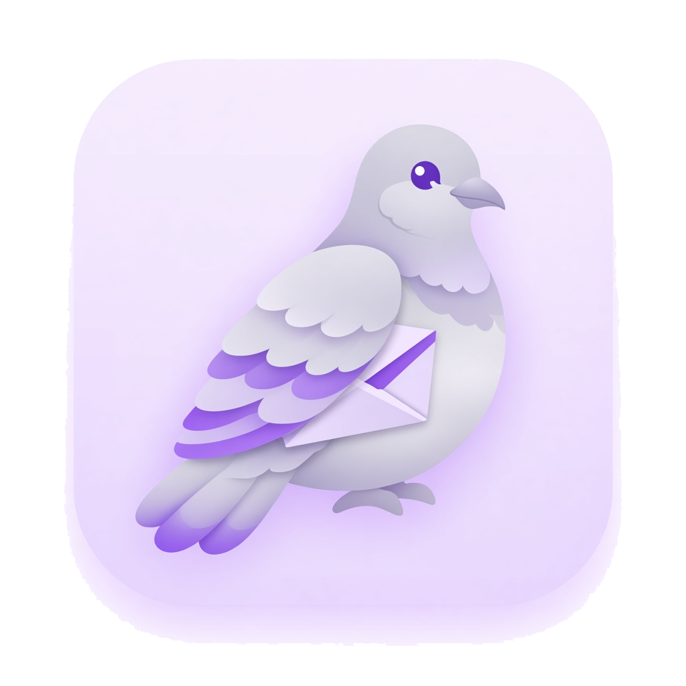

# Payra

<p align="center">
  
</p>

<p align="center">
  <strong>Desktop realtime chat for SDP-2</strong><br/>
  <em>Payra (পায়রা) = pigeon — inspired by carrier pigeons that once delivered messages.</em>
</p>

---

## What is this?

Payra is a **native desktop messenger** (Windows + macOS) built with **Python + PySide6**, backed by **Supabase** (Auth, Postgres, Realtime, Storage). Payra AI is a later phase.

| Phase | Focus | Status |
|-------|--------|--------|
| 1 | UI (login, chat shell, groups, profile) | Done |
| 2 | Supabase — auth, 1:1 + group chat, images, realtime | **Live** |
| 3 | Payra AI (separate from human chats) | Planned |

With a filled `.env`, the app uses live Supabase. Without keys it still runs in **local auth** mode for UI work. Task plan: [`docs/tasks/`](docs/tasks/).

---

## Quick start

### 1. Clone

```bash
git clone https://github.com/payra-team/payra.git
cd payra
```

### 2. Virtualenv & deps

**macOS (recommended — uv):**

```bash
brew install uv
./scripts/bootstrap_venv.sh
source .venv/bin/activate
```

**Windows / Linux:**

```bash
python -m venv .venv
# Windows: .venv\Scripts\activate
source .venv/bin/activate
pip install -r requirements.txt
```

Verify:

```bash
python -c "import PySide6, supabase; print('OK', PySide6.__version__)"
```

### 3. Supabase keys

```bash
cp .env.example .env
```

Edit `.env` with **Project URL** + **anon** key (Dashboard → Project Settings → API).  
Never put `service_role` in the desktop app. Never commit `.env`.

Details: [`docs/SUPABASE_SETUP.md`](docs/SUPABASE_SETUP.md).

**Auth tip:** for MVP signup without email links, turn **Confirm email** OFF in Supabase → Authentication → Providers → Email.

### 4. Run

```bash
source .venv/bin/activate          # Windows: .venv\Scripts\activate
export PYTHONPATH=src              # PowerShell: $env:PYTHONPATH="src"
python -m payra
```

### 5. First login

1. **Create account** (display name, username, email, password ≥ 6).
2. Sign in — main shell opens with your real inbox.
3. Use **+ New Chat** / **+ New Group**, attach images, star chats.

Sensitive actions (logout, delete, block, star) ask for confirmation first.

---

## Unit tests

```bash
source .venv/bin/activate
export PYTHONPATH=src QT_QPA_PLATFORM=offscreen
python -m unittest tests.test_add_members -v
```

## Smoke test (optional)

```bash
source .venv/bin/activate
export PYTHONPATH=src
python scripts/smoke_test_supabase.py --phase test --state /tmp/payra_smoke.json
```

Seeded test accounts (password `PayraTest1!`) if present on the project:

- `payra.smoke.a@gmail.com` · Alpha  
- `payra.smoke.b@gmail.com` · Beta  
- `payra.smoke.c@gmail.com` · Charlie  
- `payra.smoke.d@gmail.com` · Dana  

---

## Every work session

```bash
cd payra
source .venv/bin/activate
export PYTHONPATH=src
python -m payra
```

---

## Project structure

```
payra/
├── README.md
├── requirements.txt
├── .env.example
├── scripts/
│   ├── bootstrap_venv.sh
│   └── smoke_test_supabase.py
├── docs/
│   ├── SETUP_MAC.md
│   ├── SUPABASE_SETUP.md
│   ├── architecture.md
│   └── tasks/                 ← Phase 2 execution plan + status
├── design/
├── supabase/migrations/       ← schema notes (applied via Supabase MCP)
└── src/payra/
    ├── main.py                ← auth gate → main window
    ├── config.py
    ├── models/demo_data.py
    ├── services/
    │   ├── auth.py            ← Supabase or local auth
    │   ├── chat.py            ← conversations / messages / groups
    │   ├── storage.py         ← avatars + chat-images uploads
    │   ├── image_optimizer.py ← Pillow compress before Storage
    │   ├── realtime.py        ← live message inserts
    │   ├── supabase_client.py
    │   └── ai.py              ← Phase 3 stub
    ├── ui/
    │   ├── windows/           ← auth + main
    │   └── widgets/           ← nav, list, pane, dialogs, image viewer
    └── resources/             ← icons (transparent corners) + images
```

---

## Stack

| Layer | Tech |
|-------|------|
| Desktop UI | Python · PySide6 (Qt) |
| Backend | Supabase Auth · Postgres + RLS · Realtime · Storage |
| Config | `.env` + `python-dotenv` |
| AI | Deferred (Phase 3) |

---

## Team tips

1. Pull before you start — `git pull`
2. Branch for features — e.g. `feature/login-polish`
3. Don’t commit `.venv/`, `.env`, or `__pycache__/`
4. Keep PRs small
5. Mac venv issues → [`docs/SETUP_MAC.md`](docs/SETUP_MAC.md)

---

## Troubleshooting

| Problem | Fix |
|---------|-----|
| `No module named payra` | Run from repo root with `PYTHONPATH=src` |
| `No module named PySide6` | Activate `.venv`, reinstall deps |
| Signup asks to confirm email | Disable Confirm email in Supabase Auth settings |
| `email rate limit exceeded` | Wait, or create users via dashboard / SQL |
| White corners on dock icon | Use latest `resources/icons/app_icon.png` (transparent) |
| Forgot local password | Delete `~/.payra/local_users.json` + `session.json` |

---

## More docs

- [macOS setup](docs/SETUP_MAC.md)
- [Supabase setup](docs/SUPABASE_SETUP.md)
- [Architecture](docs/architecture.md)
- [Phase 2 tasks / status](docs/tasks/)
- [Assets](src/payra/resources/README.md)

---

<p align="center">
  <sub>SDP-2 · Built with ❤️ by the Payra team</sub>
</p>
